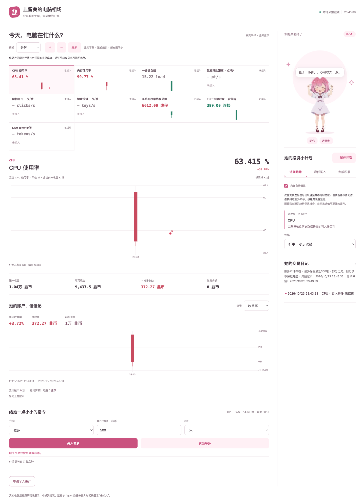
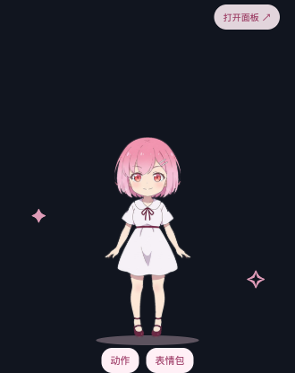
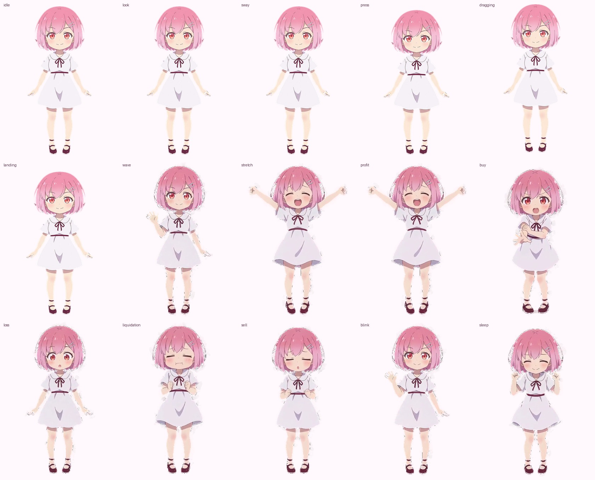

# 韭留美 · 电脑相场

让电脑的忙碌变成行情，让久留美陪你在桌面上看盘。

一只 macOS 透明桌宠，加上一间用虚拟韭币交易的本地交易所。CPU、内存、系统负载是行情来源；买入、做空、借款与破产都是游戏，不连接券商，也不操作真实资金。

[下载与版本记录](https://github.com/holooooo/FX-Fighter-Kurumi/releases/latest) · [安装说明](docs/installation.md) · [维护者发布指南](docs/release-maintainer.md)



## 桌面上的她，电脑里的行情

- 独立透明、置顶、可拖动的桌宠窗口。待机、点击、拖动和交易事件会切换角色动作，也能显示文字气泡与本地表情包。
- CPU、内存与一分钟平均负载来自当前电脑的真实采样。原生宿主还支持鼠键事件的汇总统计；未获得权限或没有数据时明确显示不可用。
- 分钟、小时、日三档 OHLC 图共享时间视窗，成交标记落在实际虚拟成交时间与价格上。历史不足不补造 K 线。
- 手动买卖、做空、杠杆、虚拟贷款与自主投资共用账本。交易日记记录可知成本、利息与净收益，刷新页面不会重置账户。
- CLI、Agent 技能和可选 DSH token 插件接入同一本地服务，不需要云端交易账户。



运行时使用 15 个带 8-bit alpha 通道的 APNG 动作，另保留 GIF 导出。动作来自同一人设图的本地变换与已有生成视频的剪辑，不是 15 条独立生成视频。



## 安装

本版面向 **Apple Silicon Mac，macOS 14 或更新版本**。下载版自带 Node 运行时，无需先安装 Node.js。Intel Mac、Windows、Linux 暂无本版安装包。

1. 在 [Releases](https://github.com/holooooo/FX-Fighter-Kurumi/releases/latest) 找到目标版本，下载 `JiuliuPet-v0.1.0-macos-arm64.zip` 和同一版本的 `SHA256SUMS`。发布完成前，下载入口可能尚无可用版本。
2. 将两者放在同一文件夹，校验后解压，把 `韭留美.app` 拖进「应用程序」。
3. 确认来源可信后打开应用。当前为本地 ad-hoc 签名，未公证；首次打开可能被 macOS 拦截，按[首次打开说明](docs/installation.md#首次打开与系统提示)操作，不要关闭系统安全检查。

校验命令在下载文件所在文件夹运行：

```bash
shasum -a 256 -c SHA256SUMS
```

校验和只能核对文件完整性，不等于发布者身份认证或 Apple 公证。端口冲突、输入监控权限、升级和卸载见[完整安装说明](docs/installation.md)。

从菜单栏「韭留美」可选择「打开面板」「显示／隐藏桌宠」或「退出韭留美」。关闭面板窗口不等于退出应用；退出时仅停止本应用自行启动的服务，不会结束复用的已有服务。

## 数据与隐私

服务仅监听 `127.0.0.1:8766`，账户、交易日记与行情存档默认保存在 `~/.kurumi/live-state.json`。这是本地虚拟交易工具，不上传交易账本到云端，也不会替你下真实订单。

鼠键统计只累计事件数量与屏幕点位移距离，不保存按键内容或鼠标轨迹；纯 Node 模式不会自动采集鼠键。DSH token 速率来自 provider 的实际 usage，未收到 usage 时不按文字长度估算。截图用于展示界面，不代表投资收益。

成交日记最多保留最近 500 条，总存档上限 2 MiB；行情另有保留数量与容量限制。旧档缺失的成本或成交记录不会补造，详情见[交易日记](docs/trade-diary.md)与[图表说明](docs/chart-trading.md)。

## 从源码运行

需要 Node.js 22+。服务无 npm 运行依赖：

```bash
git clone https://github.com/holooooo/FX-Fighter-Kurumi.git
cd FX-Fighter-Kurumi
node server.cjs
```

打开 <http://127.0.0.1:8766/pet.html>。浏览器版不提供原生透明置顶窗口，也不会自动获得原生鼠键采样。

构建 macOS 宿主需要 Xcode Command Line Tools 与可用的 Swift 6 工具链：

```bash
bash scripts/build-macos.sh
open 'output/韭留美.app'
```

打包脚本要求可独立分发、仅依赖系统动态库的 Node 可执行文件；Homebrew 版本若含外部动态库依赖会被拒绝。可通过绝对路径 `KURUMI_NODE_PATH` 指定官方独立 Node。完整构建约束见[宿主说明](docs/macos-host.md)。

```bash
node --test tests/*.test.cjs tests/*.test.mjs
bash scripts/test-native.sh
# 可选：需要完整 Xcode 的 WidgetKit 构建
bash scripts/build-widget.sh
```

这些是本地验证命令，不代表当前提交的远端 CI 已通过。版本标签触发的 GitHub Actions 发布流程、ZIP 和校验和的生成方式见[维护者发布指南](docs/release-maintainer.md)。

CLI 入口为 `node bin/kurumi.cjs status`；[Agent 接入](docs/agent-bridge.md)、[DSH token 插件](docs/dsh-plugin.md)、[虚拟金融玩法](docs/finance-gameplay.md)另有说明。

## 本版边界

- WidgetKit 扩展已有构建与系统发现记录，但小组件图库添加、实际渲染尚未完成验收，不承诺安装后可直接添加。详见[小组件说明](docs/widget.md)。
- 新梗动画三条因平台配额失败未纳入本版；首次新任务返回 `insufficient_customer_quota`、无产物后已停止其余任务。本版发布现有动作，不把未完成的生成计入成果。
- 未完成 Apple 公证、Intel 安装包、长期资源占用基准和全部外设权限组合验收。内存行情包含缓存，不等同于活动监视器的应用内存或内存压力。

## 许可与素材

项目自有代码采用 [MIT License](LICENSE)。角色、漫画参考、表情包及第三方依赖不因代码许可而自动获得同一授权；来源与使用边界见[素材归属说明](docs/asset-attribution.md)和[动画记录](docs/animation-samples.md)。本项目不是原作官方产品，勿将角色或第三方素材视为可任意商用。
